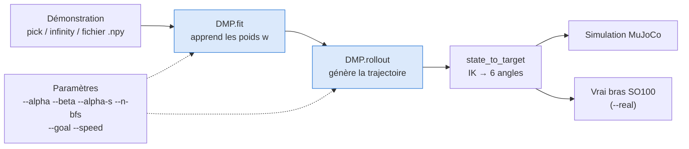

# TD Robotique


## Partie 2 : LeRobot


Voici les vidéos du robot:  

https://github.com/user-attachments/assets/6c097975-c87c-44bb-adbf-c9d0f23e321f

https://github.com/user-attachments/assets/eb477b81-6e69-4ba7-bfd6-5f6a1882882e  

https://github.com/user-attachments/assets/9c53638a-34c6-43a2-958b-94a95acc1355  

https://github.com/user-attachments/assets/7171d93b-7e13-4994-9ac3-b50cdbf5f647  

Le retour a sa position initiale :  

https://github.com/user-attachments/assets/becbd2c6-1f79-417c-afc1-f7b2befdfa70 

## I - LQR

Le LQR (*Linear Quadratic Regulator*) est un contrôleur par retour d'état qui cherche à amener ou maintenir un système à l'équilibre, le plus efficacement possible. La loi de contrôle est un retour d'état :

$$
u(t) = -K\,x(t)
$$

On a une fonction de coût

$$
J = \int_{0}^{\infty} \left( x^{T} Q x + u^{T} R u \right) dt
$$

La solution optimale est un retour d'état $u = \bar{\bar{u}} - K(x - \bar{\bar{x}})$, avec $K = R^{-1} B^{T} P$, où $P$ est la solution de l'équation algébrique de Riccati :

$$
A^{T} P + P A - P B R^{-1} B^{T} P + Q = 0
$$

Pour utiliser le LQR on a besoin d'un modèle mathématique du robot. Nous n'avons pas construit les modèles du robot nous-mêmes : ils viennent de la bibliothèque `lerobot-kinematics` :

- **Modèle cinématique.** `get_robot('so100')`, dans `lerobot_Kinematics.py`.
- **Modèle MuJoCo.** `so_100.xml` et `scene.xml`.

### I.1 Modèle $\dot{x} = Ax + Bu$

L'état contient les 6 positions et les 6 vitesses articulaires. $M$ est la matrice d'inertie lue dans MuJoCo dans la posture initiale et $D$ l'amortissement des articulations :

$$
M\ddot{q} + D\dot{q} = u
\quad \Longrightarrow \quad
\dot{x} =
\begin{bmatrix} 0 & I \\ 0 & -M^{-1}D \end{bmatrix} x
+
\begin{bmatrix} 0 \\ M^{-1} \end{bmatrix} u
$$

```python
M_full = np.zeros((mjmodel.nv, mjmodel.nv))
mujoco.mj_fullM(mjmodel, M_full, mjdata.qM)
M_robot = M_full[np.ix_(qvel_indices, qvel_indices)]
M_inv = np.linalg.inv(M_robot)
D_robot = np.diag(mjmodel.dof_damping[qvel_indices])

A_mat = np.zeros((n_states, n_states))
A_mat[:dof, dof:] = np.eye(dof)
A_mat[dof:, dof:] = -M_inv @ D_robot

B_mat = np.zeros((n_states, dof))
B_mat[dof:, :] = M_inv

C_mat = np.eye(n_states)
D_mat = np.zeros((n_states, dof))

sys_lineare = statespace.StateSpaceSystem(A_mat, B_mat, C_mat, D_mat)
```

### I.2 Choix de $Q$ et $R$

- **$Q$ grand** : l'écart coûte cher. Le mouvement est plus rapide et plus précis, avec des commandes plus fortes ;
- **$R$ grand** : l'effort coûte cher. Le mouvement est plus lent et plus doux.

Ce qui compte est le rapport $Q/R$ : multiplier $Q$ et $R$ par le même nombre donne le même $K$.

```python
def guadagno_lqr(sys_lineare, facteur_q_pos, facteur_q_vel, r):
    cf = costfunction.QuadraticCostFunction.from_sys(sys_linear)
    cf.Q = np.diag(np.concatenate([facteur_q_pos * Q_POS,
                                   facteur_q_vel * Q_VEL]))
    cf.R = r * np.eye(dof)
    xbar_init = np.concatenate([init_qpos, np.zeros(dof)])
    ctl_lqr = lqr.synthesize_lqr_controller(sys_lineare, cf,
                                            xbar=xbar_init,
                                            ubar=np.zeros(dof))
    poli = np.linalg.eigvals(sys_lineare.A - sys_lineare.B @ ctl_lqr.K)
    return ctl_lqr, poli
```

Après, dans le code, on utilise cette fonction pour les différentes valeurs de $Q$ et $R$. On fait 4 tests différents pour voir les changements sur $Q_{POS}$, sur $Q_{VEL}$ et sur $R$ séparément.

<p align="center">
  
  
</p>


### I.3 Évitement d'une zone

Pour l'évitement d'une zone, le code vérifie déjà que le trajet ne descend pas sous une hauteur minimale avant de bouger le robot : le même contrôle pourrait interdire un volume donné.


## II - DMP

Un DMP est un système dynamique stable qui converge naturellement vers une cible, auquel on ajoute un terme appris qui donne sa forme au mouvement. Ca permet d'apprendre des gestes par démonstration.
Son intérêt : une seule démonstration suffit, le mouvement converge toujours vers le but, et on peut changer le but, la durée ou le point de départ sans réapprendre.


### II.1 Le système de transformation

Chaque dimension du mouvement (position $y$) suit un ressort-amortisseur, plus un terme de forçage $f$ :

```math
\tau \dot{v} = \alpha_z \left( \beta_z (g - y) - v \right) + f(s)
```

```math
\tau \dot{y} = v
```

- $g$ : le but (position finale) ;
- $y_0$ : la position de départ ;
- $\tau$ : la durée du mouvement (le diviser accélère tout) ;
- $\alpha_z$ (« alpha ») : l'amortissement, il règle la rapidité de réaction ;
- $\beta_z$ (« beta ») : la raideur du ressort vers le but.

Sans $f$, ce système rejoint simplement $g$. Avec $\beta = \alpha/4$, il est amorti de façon critique : il arrive au but le plus vite possible sans le dépasser. Le facteur d'amortissement vaut $\zeta = \tfrac{1}{2}\sqrt{\alpha/\beta}$ : $\zeta > 1$ est suramorti (lent), $\zeta < 1$ sous-amorti (oscillations).

### II.2 Le système canonique (l'horloge)

Le temps est remplacé par une phase $s$ qui décroît de 1 vers 0 :

```math
\tau \dot{s} = -\alpha_s \, s
```

Toutes les dimensions partagent cette même phase, ce qui les garde synchronisées. $\alpha_s$ règle la vitesse à laquelle $s$ s'éteint.

### II.3 Le terme de forçage

$f$ est une somme de $N$ gaussiennes $\psi_i$ réparties le long de la phase, pondérées par des poids $w_i$ :

```math
f(s) = \frac{\sum_{i=1}^{N} \psi_i(s) \, w_i}{\sum_{i=1}^{N} \psi_i(s)} \; s, \qquad \psi_i(s) = \exp\left(-h_i (s - c_i)^2\right)
```

Comme $f$ est multiplié par $s$, il s'éteint en fin de mouvement : il ne reste alors que le ressort, qui amène le système sur le but. C'est ce qui garantit la convergence.

### II.4 Formulation utilisée : Pastor et al. (2009)

Le code utilise la variante de Pastor, qui reste stable quand le but est égal au départ (cas du signe ∞, qui finit là où il commence) :

```math
\tau \dot{v} = K (g - y) - D v - K (g - y_0) s + K f(s), \qquad K = \alpha_z \beta_z, \; D = \alpha_z
```

### II.5 L'apprentissage

À partir de la démonstration (positions, vitesses et accélérations), on calcule le forçage $f_{cible}$ qu'il aurait fallu pour la reproduire exactement. Les poids $w$ sont ensuite trouvés par moindres carrés, en une seule résolution linéaire. Apprendre un mouvement prend une fraction de seconde.

## 3. Architecture du code

Le programme `lerobot_dmp.py` enchaîne quatre étapes : obtenir une démonstration, apprendre le DMP, générer la trajectoire, puis la convertir en angles d'articulations et l'envoyer à la simulation et au robot.



Les deux étapes en couleur forment le DMP proprement dit ; les paramètres se règlent en ligne de commande (section 4).

### 3.1 L'état piloté par le DMP

Le DMP pilote un vecteur de 8 dimensions, chacune avec son propre ressort et ses propres poids, mais une phase $s$ commune :

| Indice | Grandeur | Unité | Nature |
| --- | --- | --- | --- |
| 0 | Rotation de la base | rad | articulation |
| 1 à 3 | Position de la pince x, y, z | m | repère cartésien du plan du bras |
| 4 à 6 | Orientation de la pince roll, pitch, yaw | rad | repère cartésien |
| 7 | Ouverture de la pince | rad | articulation |

La position de la pince est exprimée dans le plan vertical du bras, tel que le donne `lerobot_FK`. La rotation de la base fait tourner ce plan.

### 3.2 Les fonctions principales

| Fonction | Rôle |
| --- | --- |
| `DMP.__init__` | Crée les N gaussiennes (centres, largeurs) et calcule K = α·β, D = α |
| `DMP.fit` | Apprend les poids w à partir d'une démonstration (moindres carrés) |
| `DMP.rollout` | Intègre les équations (Euler, pas de 10 ms) vers un but g et une durée τ donnés |
| `builtin_demo` | Démonstration « pick » de 4 s |
| `infinity_demo` | Démonstration « signe ∞ » de 6 s (lemniscate de Gerono) |
| `record_demo` | Enregistre une démonstration en guidant le vrai bras à la main |
| `state_to_target` | Convertit un état DMP en 6 angles avec l'IK `lerobot_IK` |
| `play` | Joue la trajectoire dans MuJoCo et, avec `--real`, sur le vrai bras |
| `move_smoothly` | Déplace le vrai bras en douceur (profil « minimum jerk ») |
| `plot` | Trace la démo et la sortie du DMP, dimension par dimension |

### 3.3 Déroulement d'une exécution

1. La démonstration est chargée (fichier `.npy`) ou générée (`pick` ou `infinity`).
2. `DMP.fit` apprend les poids ; `DMP.rollout` produit la trajectoire, éventuellement vers un nouveau but ou à une autre vitesse.
3. Toute la trajectoire est convertie en angles avec l'IK, une fois pour toutes. Si l'IK échoue sur un point, les angles précédents sont gardés.
4. Avec `--real`, le vrai bras est connecté, ses moteurs sont activés et il rejoint la position initiale.
5. Le bras passe lentement (8 s) de la position initiale au premier point du mouvement, en simulation et sur le vrai bras.
6. Le mouvement est joué en boucle toutes les 10 ms. Une forme fermée (∞) est rejouée dans le même sens ; une forme ouverte (pick) est jouée à l'aller puis au retour.
7. À la fermeture de la fenêtre, le vrai bras revient lentement (8 s) en position repliée, puis se déconnecte.

## 4. Paramètres modifiables

Les réglages courants se changent en ligne de commande, sans toucher au code ; les autres sont des constantes en tête de `lerobot_dmp.py` ou des arguments des fonctions de démonstration.

### 4.1 En ligne de commande

| Option | Valeur par défaut | Effet |
| --- | --- | --- |
| `--alpha` | 25 | αz : amortissement, rapidité de réaction du DMP |
| `--beta` | α/4 (6,25) | βz : raideur vers le but ; α/4 = amortissement critique |
| `--alpha-s` | 4 | αs : vitesse d'extinction du terme appris |
| `--n-bfs` | 50 | Nombre de gaussiennes, donc finesse de la forme apprise |
| `--shape` | pick | Démonstration intégrée : `pick` ou `infinity` |
| `--demo` | aucune | Fichier `.npy` de démonstration enregistrée |
| `--goal X Z` | but de la démo | Nouveau but de la pince, en mètres |
| `--speed` | 1 | Facteur de vitesse (2 = deux fois plus vite) |
| `--real` | désactivé | Envoie aussi la trajectoire au vrai bras |
| `--record FICHIER` | aucun | Enregistre une démo en guidant le bras à la main |
| `--start-time` | 8 s | Durée de l'approche vers le début du mouvement |
| `--return-time` | 8 s | Durée du retour en position initiale à la fin |
| `--plot FICHIER` | aucun | Enregistre le graphe démo / DMP en PNG |

Exemples :

```bash
.venv/bin/mjpython examples/lerobot_dmp.py --shape infinity --real
.venv/bin/mjpython examples/lerobot_dmp.py --shape infinity --alpha 40 --beta 10
.venv/bin/mjpython examples/lerobot_dmp.py --goal 0.30 0.06 --speed 1.5 --plot pick.png
```

Sur macOS, la simulation se lance avec `mjpython` et non `python`, car le visualiseur MuJoCo doit tourner dans le fil principal.

### 4.2 Dans le code

| Constante ou argument | Valeur | Où | Rôle |
| --- | --- | --- | --- |
| `DT` | 0,01 s | tête du fichier | Pas d'intégration et période de commande (100 Hz) |
| `init_qpos` | [0, −3,14, 3,14, 0, −1,57, −0,157] rad | tête du fichier | Position initiale repliée |
| `control_glimit` | x de 0,10 à 0,34 m, z de 0,046 à 0,23 m | tête du fichier | Limites de sécurité de la pince |
| `PORT` | `/dev/tty.usbmodem…` | tête du fichier | Port USB du bras |
| `CALIBRATION_FILE` | `examples/main_follower.json` | tête du fichier | Fichier de calibration des moteurs |
| `settle` | 0,5 | `DMP.rollout` | Temps ajouté après τ (50 %) pour converger sur le but |
| `duration` | 4 s / 6 s | `builtin_demo` / `infinity_demo` | Durée de la démonstration |
| `center_x`, `center_z` | 0,20 m, 0,12 m | `infinity_demo` | Centre du ∞ |
| `width`, `height` | 0,5 rad, 0,04 m | `infinity_demo` | Largeur (rotation de la base) et hauteur du ∞ |
| régularisation | 1e−6 | `DMP.fit` | Stabilise la résolution des moindres carrés |

## 5. Mouvements réalisés

Les deux mouvements intégrés sont reproduits par le DMP avec un écart de 1 à 2 mm en position, et la cinématique inverse trouve une solution sur 96 à 100 % des points.

### 5.1 Le mouvement « pick »

En 4 s, la pince part de la position repliée, avance de x = 0,11 m à 0,25 m en passant par-dessus un obstacle imaginaire (z monte jusqu'à 0,17 m puis redescend à 0,08 m), tandis que la base tourne de 0,6 rad et que la pince s'ouvre puis se referme.

Chaque courbe de la démo est construite avec un profil « minimum jerk », à vitesse nulle au début et à la fin : c'est le type de mouvement qu'un DMP reproduit le mieux.


*Démo (trait plein) et DMP (pointillé) pour les 8 dimensions, en secondes. Après 4 s, le DMP continue 2 s pour se stabiliser sur le but.*

### 5.2 Le signe infini ∞

La pince se place à 20 cm devant la base et 12 cm de haut, puis trace un ∞ couché en 6 s :

- largeur : la base tourne de ±0,5 rad (environ ±29°) ;
- hauteur : z varie de ±4 cm autour de 12 cm.


La trajectoire suivie est une lemniscate de Gerono (en forme de huit couché), définie par les coordonnées horizontale $\sin(\theta)$ et verticale $\sin(2\theta)$, où l'angle $\theta$ évolue de $0$ à $2\pi$ selon un profil de vitesse minimum jerk. Le mouvement démarre et s'achève au centre à vitesse nulle, ce qui permet de l'exécuter en boucle de manière fluide et sans à-coups


### 5.3 Précision mesurée

| Mouvement | Points | Base (rad) | x (mm) | z (mm) | Pince (rad) | Échecs de l'IK |
| --- | --- | --- | --- | --- | --- | --- |
| Pick | 601 | 0,0025 | 0,6 | 1,1 | 0,015 | 10 à 21 |
| Signe ∞ | 901 | 0,0121 | 0,0 | 2,1 | 0,000 | 0 |

*Écarts maximaux entre la démonstration et la sortie du DMP.* Les échecs de l'IK du « pick » se trouvent près de la position repliée de départ, déjà difficile pour l'IK dans les exemples d'origine.

Rejoué vers un nouveau but (x = 0,30 m, z = 0,06 m), le « pick » garde sa forme et finit à x = 0,299 m, z = 0,064 m.

### 5.4 Enregistrer sa propre démonstration

Le mode `--record` coupe les moteurs : on guide le bras à la main (apprentissage kinesthésique), sa position est lue toutes les 10 ms et convertie avec la FK. Ctrl+C arrête l'enregistrement et sauve le fichier `.npy`, que `--demo` fait ensuite apprendre et rejouer.

```bash
.venv/bin/python examples/lerobot_dmp.py --record demo.npy
.venv/bin/mjpython examples/lerobot_dmp.py --demo demo.npy --real
```

## 6. Influence de α et β

α et β changent très peu la reproduction d'une démonstration, mais ils décident du comportement dès qu'on change le but ou qu'on perturbe le mouvement ; le bon compromis est α entre 25 et 50 avec β = α/4.

Les quatre graphes ci-dessous sont produits par `examples/dmp_alpha_beta_plots.py`. Chacun a deux panneaux : à gauche, α varie (5, 10, 25, 50) avec β = α/4 ; à droite, α = 25 et β varie pour donner ζ = 2 (suramorti), 1 (critique), 0,5 et 0,25 (sous-amorti).

```bash
.venv/bin/python examples/dmp_alpha_beta_plots.py
```

### 6.1 Le ressort-amortisseur seul

Sans terme appris, le système passe de 0 au but 1. Avec β = α/4, α = 50 atteint le but en 0,3 s environ, alors que α = 5 n'y est pas après 2 s. À α fixé, ζ = 0,25 dépasse le but de 40 % puis oscille, et ζ = 2 est très lent : α règle la rapidité, le rapport β/α règle les oscillations.


### 6.2 Généralisation à un nouveau but

Le « pick », appris vers z = 0,08 m, est rejoué vers z = 0,04 m. Avec α ≥ 25, le système rejoint le nouveau but ; avec α = 5, il remonte vers 0,10 m et n'y arrive pas dans le temps imparti. Un β trop grand ajoute un creux parasite au tout début.


### 6.3 Rejet d'une perturbation

Pendant le ∞, la base est poussée de +0,3 rad à t = 3 s. Avec α = 50, le mouvement revient sur la trajectoire apprise en moins d'une seconde ; avec α = 5, il dérive jusqu'à la fin et le tracé est déformé. Un système sous-amorti (ζ ≤ 0,5) oscille après la poussée.


### 6.4 Reproduction de la démonstration

Sans changement de but ni perturbation, toutes les courbes se superposent au ∞ de la démo, avec un écart maximal de 1,7 à 2,3 mm. Les poids appris compensent α et β : ces paramètres ne se voient pas tant que le robot ne s'écarte pas de ce qu'il a appris.


### 6.5 Valeurs conseillées

| Réglage | Comportement | Usage |
| --- | --- | --- |
| α = 25, β = 6,25 (défaut) | Rapide, sans dépassement | Usage général |
| α = 50, β = 12,5 | Très réactif, rejette vite les perturbations | Environnement perturbé |
| α ≤ 10 | Lent, n'atteint pas toujours un nouveau but | À éviter |
| β > α/4 | Oscillations autour du but | À éviter sur le vrai bras |

## 7. Mise en œuvre sur le robot réel

Le DMP a tourné sur le vrai bras SO100, synchronisé avec la simulation, pour le « pick » et le signe ∞, sans perte de communication pendant ces essais.

### 7.1 Liaison simulation / robot

À chaque pas de 10 ms, les mêmes 6 angles sont envoyés à MuJoCo et aux moteurs (`feetech_arm.action`). Le pilote convertit les radians de la simulation en degrés moteurs et inverse le sens de trois articulations (base, épaule, rotation du poignet), montées à l'envers.

### 7.2 Calibration

La calibration fait correspondre la valeur brute de chaque moteur (0 à 4095 pas par tour) à un angle. Le projet lit un fichier JSON (`homing_offset`, `drive_mode`, `start_pos`, `end_pos`) au format de l'ancien LeRobot. Le fichier utilisé est la calibration « de base » des kits SO100 fournie avec lerobot-joycon, dont les positions lues ont été vérifiées sur la pose réelle du bras.

Un script [`examples/calibrate_so100.py`](examples/calibrate_so100.py) permet aussi de recalibrer à la main en trois poses (zéro, tournée d'un quart de tour, repos). Il refuse d'enregistrer si une articulation a trop peu (< 45°) ou trop (> 135°) tourné.

### 7.3 Sécurité

- Les moteurs gardent d'abord leur position actuelle, puis sont activés : pas d'à-coup au démarrage.
- Approche de 8 s vers le début du mouvement et retour de 8 s en position repliée, avec un profil minimum jerk.
- La position de la pince est limitée à x entre 0,10 et 0,34 m et z entre 0,046 et 0,23 m.

### 7.4 Difficultés rencontrées

| Problème | Cause | Solution |
| --- | --- | --- |
| Pas de fenêtre de simulation sur macOS | Le visualiseur MuJoCo exige le fil principal | Lancer avec `mjpython` |
| Touches clavier ignorées | Autorisation d'accessibilité macOS absente | Lecture des touches dans la fenêtre MuJoCo |
| Calibrations successives incohérentes | Une autre calibration (LeRobot récent) réécrit la mémoire des moteurs | N'utiliser qu'une seule méthode de calibration |
| Coupures de communication | Câble USB débranché ou alimentation insuffisante | Vérifier la tension (environ 7 V) et le câble |
| Forme du ∞ déformée | Régression locale trop lisse | Moindres carrés globaux sur les poids |

Lors des derniers essais, les moteurs ne recevaient que 4,8 V au lieu d'environ 6,8 V mesurés au début : le bras manque alors de force et peut fléchir.

## 8. Conclusion et perspectives

Le DMP reproduit les deux mouvements à 2 mm près, les adapte à un nouveau but ou à une autre vitesse sans réapprentissage, et pilote le vrai bras en synchronisation avec la simulation. L'étude de α et β montre que leur effet apparaît surtout hors de la démonstration : changement de but, perturbation, convergence finale.

Pistes d'amélioration :

- un DMP rythmique (périodique) pour tracer le ∞ en continu, sans arrêt au centre à chaque tour ;
- une boucle fermée qui relit la position réelle des moteurs et la réinjecte dans le DMP, pour réagir à une vraie perturbation ;
- une IK qui ne bloque pas près de la position repliée ;
- l'enregistrement de démonstrations réelles avec `--record`, une fois l'alimentation du bras stabilisée.

## Sources

- A. J. Ijspeert, J. Nakanishi, H. Hoffmann, P. Pastor, S. Schaal, « Dynamical Movement Primitives: Learning Attractor Models for Motor Behaviors », *Neural Computation*, 2013.
- P. Pastor, H. Hoffmann, T. Asfour, S. Schaal, « Learning and Generalization of Motor Skills by Learning from Demonstration », *ICRA*, 2009.
- [lerobot-kinematics](https://github.com/box2ai-robotics/lerobot-kinematics) et [lerobot-joycon](https://github.com/box2ai-robotics/lerobot-joycon), Box2AI Robotics.


